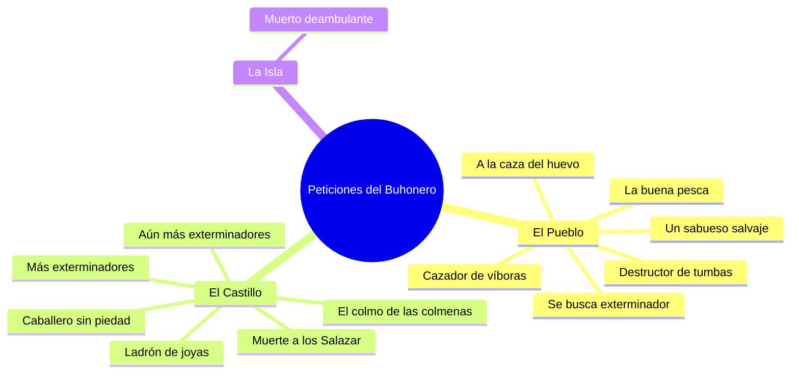

# Reseña y guía de Resident Evil 4 Remake

## Índice

#### 1. [ Introducción y Contexto](#-1-introducción-y-contexto)
#### 2. [ Argumento y Supervivencia](#-2-argumento-y-supervivencia)
#### 3. [ Mecánicas, Combate y Arsenal](#-3-mecánicas-combate-y-arsenal)
#### 4. [ Trucos que te ayudarán en dificultades altas](#-4-trucos-que-te-ayudarán-en-dificultades-altas)
#### 5. [ Veredicto y Conclusión](#-5-veredicto-y-conclusión)

---

## [🧟 1. Introducción y Contexto](#índice)

Resident Evil 4 Remake nos pone en la piel del protagonista **Leon Scott Kennedy**, que tras los acontecimientos sucedidos en ***Racoon City***, el presidente de los Estados Unidos le ha enviado a un lugar rural de Europa (~~España~~) a que rescate a su hija, **Ashley Graham**, que ha sido secuestrada por un culto religioso.  

> **30 de septiembre de 1998... Es un día que nunca olvidaré.**


Con esta frase comienza la historia de esta entrega de *Resident Evil* dejando estas nuevas incógnitas:

- [ ] ¿Habrá cambiado Leon?
- [ ] ¿Serán Leon y Ashley capaces de escapar de esta nueva pesadilla?
- [x] ¿Tendrá Leon algún reencuentro con algún personaje importante de la saga?
- [ ] ¿Conoceremos nuevos compañeros que nos acompañen en esta nueva aventura?

> [!WARNING]
> ⚠️ A partir de aquí se incluirán todo tipo de *Spoilers*

---

## [🦴 2. Argumento y Supervivencia](#índice)


---

## [🔫 3. Mecánicas, Combate y Arsenal](#índice)

---

## [📖 4. Trucos que te ayudarán en dificultades altas](#índice)

### Primer combate en El Pueblo

Llegar a esta sección nada más a principios del juego en modo profesional puede llegar a ser algo duro, pero no te preocupes, porque hay dos maneras de superar esta sección de manera sencilla.

1. **Esperar a que suene la campana**

   Esta opción si no lo piensas mucho te puede resultar ser la más fácil y la que te requiera menos intentos, pero aparte de que es inviable pasarte esta sección de dicha forma (ya que puedes tardar entre 4-5 minutos huyendo sin parar) y encima es bastante complicado porque se te van a amontonar los ganados y es muy probable que recibas golpes y agarres por todos lados, además que será casi inevitable que desencadenes un spawn de **Doctor Salvador**, que ya detallaré que acciones triggerean su aparición.

2. **Enfrentarnos a los ganados**

   Esta estrategia además de ser la que siempre aplico en mis partidas, es también la que optan todos los *speedrunners* profesionales del videojuego, ya que con ella te salvas tiempo y sabes hacer un *pathing* en donde recojas todos los recursos posibles y te ahorres recibir daño, por eso dejo aquí la siguiente imágen con todas las marcas de objetos importantes y el pathing que sigo yo para recoger recursos al menos al inicio de la oleada.

   
   <!--Como se ve en la imágen, he marcado con sus respectivos icónos todos los objetos que nos podremos encontrar por el escenario-->

   Como se puede encontrar en el mapa, esos son todos los objetos que tenemos repartidos a lo largo del escenario además de la **escopeta** que se encuentra en la casa que se encuentra el segundo piso, además de la primera granada asegurada que se encontrará a su izquierda y la primera munición de escopeta que se encuentra justo en frente, en una cama.

   Una vez sabemos que objetos podemos encontrar, hay recalcar que para pasarse esta sección en modo profesional tienes que matar un total de $15 \text{ enemigos}$, pero teniendo en cuenta que a partir de acabar con el décimo enemigo se triggeará un enemigo más letal, **el doctor Salvador**, dicho esto, pasamos a la siguiente sección.

   1. **Spawns de Doctor Salvador**
  
        A lo largo de este escenario no solo podremos *spawnear* una vez este enemigo, sino **tres** a la misma vez, aquí una lista de posibilidades:

       1. El Dr. Salvador que se puede triggerear al matar 10 enemigos.
            - Si tratas de hacerte el listillo e irte directamente al siguiente escenario (siguiendo el camino de la izquierda una vez sobrepasas la casa de la escopeta) este Dr. Salvador aparecerá por la puerta antes aunque no hayas matado a ningún enemigo.
         2. El Dr. Salvador que aparece una vez te metes en la casa de dos pisos (la casa de la escopeta).
         3. El Dr. Salvador que aparece si te encuentras muy cerca de donde está la hierba roja marcada en el mapa **y** te atrapa un enemigo que se encuentra custodíandola.

     > [!TIP]
     > Recomiendo solo activar 1 spawn de este enemigo, ya que llegar a spawnear 2 o incluso 3 será un total caos ya que es de los pocos enemigos que te puede hacer ***instakill***.

   2. **Diagrama de flujo de recomendación de como moverse por el escenario**
    <!--Diagrama de flujo en donde detallo como más o menos hago yo mis runs en esta sección-->

     ```mermaid
     flowchart TD
        %%este diagrama está hecho dando por hecho de que no es la primera vez que has jugado esta sección y que has consultado el mapa

         A[Llego al nivel] --> B[Bordeo el escenario por el camino largo de la izquierda]
         B --> C[Sigo recto]
         C --> D{¿Tengo cuchillo?}

         D -->|Sí| E[Asesino a la enemiga que tengo en frente con ataque sigiloso y rompo la caja]
         E --> G[Voy a la derecha pasando entre las dos casas]

         D -->|No| F{¿Tengo balas y recursos?}
         F -->|Sí| F1[Le pego un tiro y rompo la caja]
         F -->|No| F2[Rompo la caja y huyo]
         F1 --> G
         F2 --> G

         G --> H{¿Tengo enemigos entre esa sección?}

         H -->|Sí| I{¿Tengo recursos?}
         I -->|Sí| I1[Disparo a la cabeza para matar o aturdir y me voy a la caseta de la vaca]
         I -->|No| I2[Doy media vuelta y voy por otro lado para la caseta de la vaca]

         H -->|No| J[Voy directo a la caseta de la vaca]

         I1 --> K[Consigo recursos]
         I2 --> K
         J --> K

         K --> L[Voy a la derecha, hacia la casita solitaria]
         L --> M[Rompo cajas]
         M --> N[Salto por la ventana]
         N --> O[Voy al fondo del borde del camino]
         O --> P[Rompo la caja]
         P --> Q[Salto la valla]

         Q --> R{¿Tengo enemigos en frente mía?}
         R -->|Sí| R1[Intento matar a los que pueda]
         R -->|No| R2[Busco y guardo distancia para acabar con algunos]

         R1 --> S{¿Se amontonan muchos?}
         R2 --> S

         S -->|Sí| S1[Disparo a la lámpara de aceite de la caseta de la vaca para que los arrolle o me voy a la casa de la escopeta]
         S -->|No| S2[Improviso hasta que aparezca el primer Dr. Salvador e improviso hasta que suene la campana]

         S1 --> T[Improviso hasta que suene la campana]
         S2 --> T
         
[vídeo demostrativo aquí]()


### Peticiones del buhonero

Como ya se ha visto a lo largo de nuestras primeras partidas en este título, el buhonero nos irá dejando varias de sus peticiones a lo largo de los capítulos, aquí un *mindmap* con todos ellos divididos por las secciones del juego:


[detalles de cada petición aquí](https://vandal.elespanol.com/guias/guia-resident-evil-4-remake-trucos-consejos-y-secretos/peticiones)


Una vez visto esto, ¿por qué es tan importante tener en cuenta estas peticiones? pues uno de nuestros objetivos para pasarnos el modo profesional es intentar conseguir lo más rápido posible el **ticket de mejora**, ya que con ella contaremos con una mejora extra gratuita, que dependiendo del arma pues puede aumentarnos el daño de las balas de manera exponencial o incluso hacer que un arma cuente con munición infinita (la Chicago Sweeper, nuestra arma prioritaria).  
Aquí un diagrama


La manera más óptima de conseguir el ticket es asegurarnos de hacer **todas** las peticiones del buhonero del pueblo, ya que con ellas una vez llegamos a la parte del castillo el buhonero ya nos la venderá y tendremos las espinelas justas y necesarias.

### Extras convenientes que nos facilitarán la run

| Nombre | Tipo de extra | Cómo se consigue | Nivel de necesidad |
|---|---|---|---|
| Chicago Sweeper | Arma (SMG) | Completar la historia en Profesional con rango A (menos de 7 horas) y comprarla en la Tienda de Contenido Extra por 1000 CP | Muy Alta (podremos usar el ticket de mejora para tener munición infinita con este arma) |
| Armadura de Ashley | Atuendo | Completar la historia en Hardcore o superior con rango A (menos de 10 horas) y comprarla por 2000 CP | Muy alta (Ashley se vuelve invulnerable y no puede ser llevada por enemigos) |
| Handcannon | Arma (Magnum) | Completar Profesional sin armas de bonificación, **o** obtener rango S en los 3 mapas del modo Mercenarios y comprarla por 1000 CP | Media (poder de fuego brutal con munición infinita al mejorarla con el ticket de mejora, pero requiere desbloqueo previo) |
| Sombrero de gallina | Accesorio (Leon) | Completar la historia en Hardcore o Profesional con rango S+ (menos de 5h 30min) y comprarlo por 2500 CP | Media (reduce bastante el daño recibido) |
| Cuchillo Primario (Primal Knife) | Arma (cuchillo) | Destruir los 16 Castellanos Mecánicos y comprarlo en la Tienda de Contenido Extra por 1000 CP | Media (se vuelve **indestructible** con el ticket de mejora, o tenerlo como un cuchillo extra junto al cuchillo inicial) |


## [🏆 5. Veredicto y Conclusión](#índice)

Ya sabiendo de antemano todo lo anteriormente mencionado en este **README**, aquí dejo la siguiente tabla con todos los tiempos mínimos y necesarios para conseguir el rango *S+* en cada dificultad:

| Dificultad | Tiempo máximo | Requisitos adicionales |
|:---|:---:|---:|
| Asistido | 4 horas | Partida nueva (no NG+) |
| Estándar | 5 horas | Partida nueva (no NG+) |
| Hardcore | 5 horas y 30 minutos | Partida nueva (no NG+) |
| Profesional | 5 horas y 30 minutos | Partida nueva (no NG+) y máximo 15 guardados manuales |

Además de dejar un diagrama con **mis tiempos** y detalles importantes que merecen la pena resaltar como la compra de lanzacohetes para acabar con ciertos *bosses* de manera eficaz.

(aqui va la tabla)

Dicho esto, ***Resident Evil 4 Remake*** se puede considerar un juego al que le tienes que hechar bastantes horas comparados a otros de sus títulos, como ***Resident Evil Requiem*** que requiere de menos tiempo para platinar; pero no por ello lo hace imposible de completar, se consideraría un juego desafiante y que requiera de horas de juego, pero divertido en su proceso.

Además de que una vez terminado, la comunidad de modding de este juego es bastante activa, como sucede como su versión original, por lo que una vez visto todo el contenido (incluyendo el DLC *Separate ways* que cuenta también con sus rangos de dificultad y clasificaciones; y el modo gratuito de mercenarios), puede que te guste lo que la comunidad pueda ofrecer, siempre que tengas ganas de más


¡Gloria a las Plagas!
