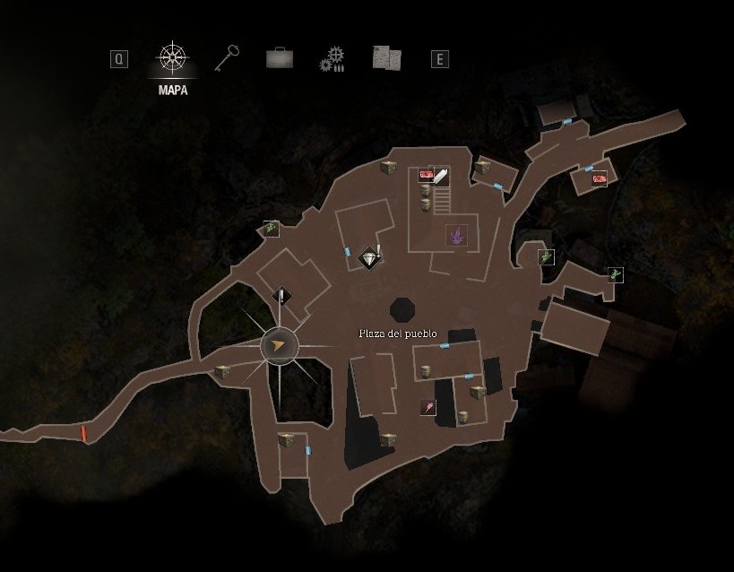
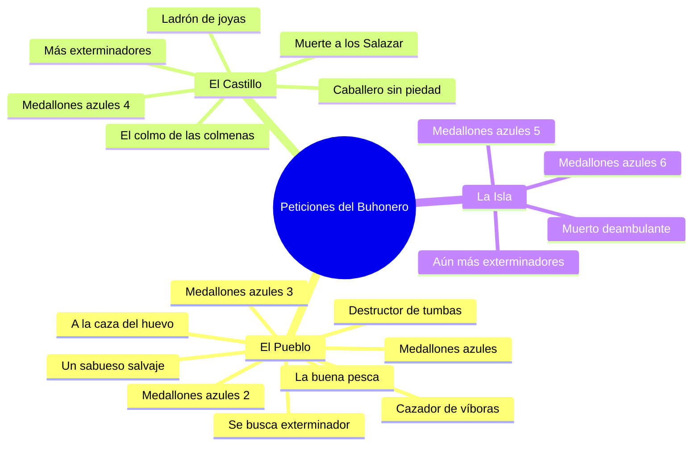

<table align="center" width="100%">
  <tr>
    <td style="text-align: center; padding: 15px; background-color: #8B0000; border-radius: 8px;">
      <h1 style="margin: 0; color: #F5F5DC;">Reseña y guía de Resident Evil 4 Remake</h1>
    </td>
  </tr>
</table>

## Índice

#### 1. [ Introducción y Contexto](#-1-introducción-y-contexto)
#### 2. [ Argumento y Supervivencia](#-2-argumento-y-supervivencia)
#### 3. [ Mecánicas, Combate y Arsenal](#-3-mecánicas-combate-y-arsenal)
#### 4. [ Trucos que te ayudarán en dificultades altas](#-4-trucos-que-te-ayudarán-en-dificultades-altas)
#### 5. [ Veredicto y Conclusión](#-5-veredicto-y-conclusión)

---

## [🧟 1. Introducción y Contexto](#índice)

Resident Evil 4 Remake nos pone en la piel del protagonista **Leon Scott Kennedy**, que tras los acontecimientos sucedidos en ***Racoon City***, el presidente de los Estados Unidos le ha enviado a un lugar rural de Europa (~~España~~) a que rescate a su hija, **Ashley Graham**, que ha sido secuestrada por un culto religioso.  

> **30 de septiembre de 1998... Es un día que nunca olvidaré.**


Con esta frase comienza la historia de esta entrega de *Resident Evil* dejando estas nuevas incógnitas:

- [ ] ¿Habrá cambiado Leon?
- [ ] ¿Serán Leon y Ashley capaces de escapar de esta nueva pesadilla?
- [x] ¿Tendrá Leon algún reencuentro con algún personaje importante de la saga?
- [ ] ¿Conoceremos nuevos compañeros que nos acompañen en esta nueva aventura?

> [!WARNING]
> ⚠️ A partir de aquí se incluirán todo tipo de *Spoilers*

---

## [🦴 2. Argumento y Supervivencia](#índice)

### Personajes principales

Como es propio de esta franquicia, **Capcom** nos presenta a los siguientes personajes a lo largo de la aventura.

| Imagen | Personaje | Descripción breve | Facción |
| :---: | :--- | :--- | :--- |
|  | **Leon S. Kennedy** | Superviviente de Raccoon City y agente del gobierno de EE. UU. Enviado a España para rescatar a Ashley, combina su entrenamiento policial con una determinación inquebrantable. | Gobierno de los Estados Unidos |
|  | **Ashley Graham** | Hija del presidente de los Estados Unidos. Secuestrada por Los Iluminados para ser usada como peón en sus planes, deberá confiar en Leon para sobrevivir y volver a casa. | Civil (secuestrada) |
|  | **Luis Serra** | Ex-investigador de Umbrella. Atormentado por su pasado, busca redimirse ayudando a Leon y Ashley a combatir las Plagas, proporcionando información clave sobre el parásito. | Independiente (ex-Umbrella) |
|  | **Ada Wong** | Misteriosa espía que se cruza en el camino de Leon. Sus motivos y su lealtad son ambiguos, y siempre parece estar un paso por delante, persiguiendo sus propios objetivos. | Independiente (contratada por Albert Wesker) |

### Tesoros

Una vez nos hemos familiarizado con los personajes principales del juego, podemos pasar a una mecánica rescatada de la versión original: la combinación de tesoros para multiplicar su valor. 

El sistema funciona de la siguiente manera: cada tesoro tiene un **valor base**, y si le incrustamos **gemas de colores** (rojas, azules, verdes, amarillas y moradas), dicho valor se multiplica. El multiplicador final **no depende de la gema individual**, sino de la **combinación exacta** que formemos en los huecos del tesoro.

Para calcular el valor final de un tesoro, aplicamos la siguiente fórmula:

$$
\text{Valor Final} = \text{Valor Base} \times \text{Multiplicador de Combinación}
$$

Por ejemplo, si incrustamos un **trío de gemas del mismo color** (ej. tres gemas rojas) en un tesoro, el multiplicador base del objeto se multiplicará por $1.4$:

$$
\text{Valor Final} = \text{Valor Base} \times 1.4
$$

#### Tabla de bonificaciones por combinación

Aquí tienes las combinaciones más efectivas y sus multiplicadores, según el número de gemas y sus colores:

| Combinación | Descripción | Ejemplo visual | Multiplicador |
| :--- | :--- | :---: | :---: |
| **Dos colores** | Dos gemas de colores diferentes | 🔴 🔵 | **x1.1** |
| **Dúo** | Dos gemas del mismo color | 🔴 🔴 | **x1.2** |
| **Tres colores** | Tres gemas de colores diferentes | 🔴 🔵 🟡 | **x1.3** |
| **Trío** | Tres gemas del mismo color | 🔴 🔴 🔴 | **x1.4** |
| **Dos dúos** | Dos parejas de gemas (ej. dos rojas y dos azules) | 🔴 🔴 🔵 🔵 | **x1.5** |
| **Cuatro colores** | Cuatro gemas de colores diferentes | 🔴 🔵 🟡 🟢 | **x1.6** |
| **Cuarteto** | Cuatro gemas del mismo color | 🔴 🔴 🔴 🔴 | **x1.7** |
| **Dúo y trío** | Una pareja y un trío (ej. dos rojas y tres verdes) | 🔴 🔴 🟢 🟢 🟢 | **x1.8** |
| **Quinteto** | Cinco gemas del mismo color | 🔴 🔴 🔴 🔴 🔴 | **x1.9** |
| **Cinco colores** | Cinco gemas de colores diferentes | 🔴 🔵 🟡 🟢 🟣 | **x2.0** |

> [!TIP]
> **La regla de oro:** Las combinaciones de **5 gemas** son las que más rentabilidad te darán a largo plazo. Si vas a vender un tesoro con 5 huecos, intenta siempre formar un **Quinteto** (x1.9) o un **Cinco colores** (x2.0) para maximizar las pesetas. 
> 
> Ten en cuenta que las gemas de colores son un recurso limitado, por lo que a veces no podrás completar la combinación perfecta. En esos casos, prioriza no dejar huecos vacíos: cualquier multiplicador (incluso el x1.1) es mejor que dejar el tesoro sin gemas.

---

## [🔫 3. Mecánicas, Combate y Arsenal](#índice)

### Inteligencia Artificial (IA) y Lógica de los NPCs

En el desarrollo de *Resident Evil 4 Remake*, los enemigos y los acompañantes están controlados por sistemas de Inteligencia Artificial basados en **Máquinas de Estados Finitos (FSM)**. La RE Engine evalúa constantemente variables como la distancia, la línea de visión y el inventario del jugador para ejecutar una acción u otra.

Aquí tienes una simulación de cómo podría ser el código oculto tras las IAs más importantes del juego.

>[!NOTE]
>A continuación todas las líneas de código no son sacadas del propio juego, tómalo como guías visuales para entender el comportamiento de los personajes y enemigos.

- #### La IA de Ashley
A diferencia del juego original, Ashley en el Remake no se queda quieta esperando. Su IA está diseñada para mantener una distancia de seguridad y evitar ser capturada. Si Leon apunta en su dirección, ella se agacha automáticamente para no recibir fuego amigo, y si un enemigo se acerca demasiado, entra en estado de pánico.

```csharp
// Lógica de evasión de Ashley
void ActualizarAshley(float distanciaLeon, bool leonApuntando, int enemigosCerca) {
    
    // Si Leon apunta cerca, Ashley se agacha para no bloquear el tiro
    if (leonApuntando && distanciaLeon < 8.0f) {
        CambiarEstado("Agacharse_Evadir_Fuego");
    } 
    // Si un enemigo está muy cerca, ella retrocede y esquiva
    else if (enemigosCerca > 0 && distanciaLeon < 5.0f) {
        CambiarEstado("Retroceder_Panico");
    } 
    // Si no hay peligro, se mantiene a una distancia segura
    else {
        CambiarEstado("Mantener_Distancia_Segura");
    }
}
```

- #### La IA de los Ganados
La IA de los aldeanos infectados tiene dos objetivos principales: dañar a Leon o secuestrar a Ashley. Si Ashley está en su línea de visión, su lógica de pathfinding prioriza ir a por ella, ignorando a Leon si es posible. Además, si detectan a Leon por la espalda, ejecutan una animación de agarre para inmovilizarlo.

```python
import random

# Definimos los tipos de Plaga que puede tener un Ganado
class TipoPlaga:
    NINGUNA = 0
    GUADANA = 1  # Plaga que saca cuchillas de la cabeza
    CIEGA = 2    # Plaga que te agarra y te saca los ojos (instakill sin cuchillo)

def actualizar_ganado(distancia_leon, distancia_ashley, leon_de_espaldas, bala_cerca, inventario_ganado):
    
    # 1. Evasión de disparos
    if bala_cerca and random.random() < 0.30: # 30% de probabilidad de esquivar
        return "Esquivar_Bala_Agacharse"
        
    # 2. Prioridad de secuestro
    if distancia_ashley < 10.0:
        return "Perseguir_y_Secuestrar_Ashley"
    
    # 3. Ataque por la espalda
    elif leon_de_espaldas and distancia_leon < 3.0:
        return "Agarre_Por_La_Espalda_Inmovilizar"
        
    # 4. Lanzamiento de objetos (solo si el objeto es arrojable)
    elif distancia_leon > 10.0 and distancia_leon < 20.0:
        if inventario_ganado.tiene_objeto() and inventario_ganado.objeto_actual.es_arrojable:
            return "Lanzar_Objeto_Contundente"
            
    # 5. Ataque cuerpo a cuerpo
    elif distancia_leon < 15.0:
        return "Perseguir_y_Atacar_Leon"
        
    else:
        return "Patrullar"

# Lógica al morir el enemigo (Mutación por Plaga)
def al_morir_ganado(tipo_plaga):
    if tipo_plaga == TipoPlaga.GUADANA:
        ejecutar_animacion("Brotes_Guadana")
        # El enemigo sigue vivo y ataca con cuchillas
    elif tipo_plaga == TipoPlaga.CIEGA:
        ejecutar_animacion("Cabeza_Torcida")
        # Si te agarra y no tienes cuchillo, es instakill

```

- #### La IA de Luis Serra
Luis es el NPC más complejo porque actúa como soporte dinámico. Su IA analiza el inventario de Leon para darle el recurso que más necesita (por ejemplo, si a Leon le quedan pocas balas de pistola, Luis le lanzará munición de pistola). Además, tiene la capacidad de inmovilizar a los enemigos para que Leon pueda rematarlos.

```python
# Script de soporte de Luis en combate
def actualizar_luis(municion_leon_pistola, enemigos_vivos):
    if municion_leon_pistola <= 10:
        lanzar_objeto("Municion_Pistola")
    
    for enemigo in enemigos_vivos:
        if enemigo.esta_cerca_de_leon and not enemigo.esta_inmovilizado:
            # Luis inmoviliza al enemigo para que Leon lo remate
            enemigo.ejecutar_agarre("Inmovilizado_Por_Luis")
            print("¡Luis ha inmovilizado a un enemigo!")
```

### El sistema de botín (Loot) y el "Director" del juego

En *Resident Evil 4 Remake*, el botín no es completamente aleatorio. El juego combina una **matriz base de probabilidades** con un sistema dinámico llamado **Drop Adaptativo** (o *Director*) que analiza tu estado en tiempo real.

#### 1. La matriz base de Cajas y Enemigos
Para empezar, el juego define una tabla estática de qué tipos de objetos pueden salir de las cajas y de los enemigos. Podemos representar esta tabla como una matriz \(M\), donde las filas son las fuentes (Caja, Enemigo) y las columnas son los tipos de objeto (Munición, Hierba, Dinero, **Espinela** y Nada):

$$
M = \begin{bmatrix}
0.35 & 0.20 & 0.25 & 0.002 & 0.198 \\
0.40 & 0.05 & 0.30 & 0.001 & 0.249
\end{bmatrix}
\begin{matrix} \leftarrow \text{Caja} \\ \leftarrow \text{Enemigo} \end{matrix}
$$

*(Nota: Los valores son estimaciones basadas en el juego y el datamining, pero la proporción es la clave).*

Si definimos un vector de valor $(V = [\text{Munición}, \text{Hierba}, \text{Dinero}, \text{Espinela}, \text{Nada}])$, podemos calcular el **valor esperado** de romper una caja o matar a un enemigo multiplicando la matriz por el vector de valor:

$$
E = M \times V^T = \begin{bmatrix}
(0.35 \times V_{\text{Mun}}) + (0.20 \times V_{\text{Hie}}) + \dots \\
(0.40 \times V_{\text{Mun}}) + (0.05 \times V_{\text{Hie}}) + \dots
\end{bmatrix}
$$

Matemáticamente, **romper cajas** suele dar un valor esperado más alto que matar enemigos, ya que la probabilidad de obtener recursos útiles es más equilibrada. 

> [!NOTE]
> **El "milagro" de la Espinela:** Como puedes ver en la matriz, la probabilidad de que un enemigo o una caja suelten una espinela es **ínfima** (apenas un 0.1%). Sin embargo, ese pequeño porcentaje existe. Si tienes la suerte de que te caiga una, tendrás alguna espinela extra para el Ticket de mejora o algo más que te ofrezca el buhonero.

#### 2. El Drop Adaptativo (El "Director")
Aquí está la magia: la matriz \(M\) no es fija. El juego tiene un sistema llamado *Director* que modifica dinámicamente esos pesos (\(w_k\)) basándose en tu salud (\(S\)) y tu munición (\(A\)). 

Podemos modelar la probabilidad final \(P(\text{Ítem})\) como la suma de los pesos base modificados por un factor de ajuste dinámico \(f_k\):

$$
P(\text{Ítem}) = \sum_{k=1}^{n} w_k \cdot f_k(S, A)
$$

-   **Si tu salud \(S\) tiende a 0:** El factor de ajuste para las hierbas se dispara, haciendo que las cajas y los enemigos suelten curas con mayor frecuencia.


$$
\lim_{S \to 0} f_{\text{hierba}}(S) = \infty
$$


-   **Si te quedas sin munición de un arma:** El factor para ese tipo de bala aumenta, evitando que te quedes estancado.

> [!WARNING]
> **El "castigo" al acumulador:** El Director también funciona a la inversa. Si tienes el inventario lleno de munición, el juego reduce drásticamente la probabilidad de soltar más balas (el factor \(f_k\) se vuelve muy pequeño). Por eso, en una run de S+, es mejor **no acumular** en exceso; mantén tu inventario en un punto medio para que el juego siga generando recursos útiles tanto en cajas como en enemigos.

---

## [📖 4. Trucos que te ayudarán en dificultades altas](#índice)

### Primer combate en El Pueblo

Llegar a esta sección nada más a principios del juego en modo profesional puede llegar a ser algo duro, pero no te preocupes, porque hay dos maneras de superar esta sección de manera sencilla.

1. **Esperar a que suene la campana**

   Esta opción si no lo piensas mucho te puede resultar ser la más fácil y la que te requiera menos intentos, pero aparte de que es inviable pasarte esta sección de dicha forma (ya que puedes tardar entre 4-5 minutos huyendo sin parar) y encima es bastante complicado porque se te van a amontonar los ganados y es muy probable que recibas golpes y agarres por todos lados, además que será casi inevitable que desencadenes un spawn de **Doctor Salvador**, que ya detallaré que acciones triggerean su aparición.

2. **Enfrentarnos a los ganados**

   Esta estrategia además de ser la que siempre aplico en mis partidas, es también la que optan todos los *speedrunners* profesionales del videojuego, ya que con ella te salvas tiempo y sabes hacer un *pathing* en donde recojas todos los recursos posibles y te ahorres recibir daño, por eso dejo aquí la siguiente imágen con todas las marcas de objetos importantes y el pathing que sigo yo para recoger recursos al menos al inicio de la oleada.

   
   <!--Como se ve en la imágen, he marcado con sus respectivos icónos todos los objetos que nos podremos encontrar por el escenario-->

   Como se puede encontrar en el mapa, esos son todos los objetos que tenemos repartidos a lo largo del escenario además de la **escopeta** que se encuentra en la casa que se encuentra el segundo piso, además de la primera granada asegurada que se encontrará a su izquierda y la primera munición de escopeta que se encuentra justo en frente, en una cama.

   Una vez sabemos que objetos podemos encontrar, hay recalcar que para pasarse esta sección en modo profesional tienes que matar un total de $15 \text{ enemigos}$, pero teniendo en cuenta que a partir de acabar con el décimo enemigo se triggeará un enemigo más letal, **el doctor Salvador**, dicho esto, pasamos a la siguiente sección.

   1. **Spawns de Doctor Salvador**
  
        A lo largo de este escenario no solo podremos *spawnear* una vez este enemigo, sino **tres** a la misma vez, aquí una lista de posibilidades:

       1. El Dr. Salvador que se puede triggerear al matar 10 enemigos.
            - Si tratas de hacerte el listillo e irte directamente al siguiente escenario (siguiendo el camino de la izquierda una vez sobrepasas la casa de la escopeta) este Dr. Salvador aparecerá por la puerta antes aunque no hayas matado a ningún enemigo.
         2. El Dr. Salvador que aparece una vez te metes en la casa de dos pisos (la casa de la escopeta).
         3. El Dr. Salvador que aparece si te encuentras muy cerca de donde está la hierba roja marcada en el mapa **y** te atrapa un enemigo que se encuentra custodíandola.  

> [!TIP]
> Recomiendo solo activar 1 spawn de este enemigo, ya que llegar a spawnear 2 o incluso 3 será un total caos ya que es de los pocos enemigos que te puede hacer ***instakill***.

   2. **Diagrama de flujo de recomendación de como moverse por el escenario**
      <!--Diagrama de flujo en donde detallo como más o menos hago yo mis runs en esta sección-->

      ```mermaid
      flowchart TD
         %%este diagrama está hecho dando por hecho de que no es la primera vez que has jugado esta sección y que has consultado el mapa

         A[Llego al nivel] --> B[Bordeo el escenario por el camino largo de la izquierda]
         B --> C[Sigo recto]
         C --> D{¿Tengo cuchillo?}

         D -->|Sí| E[Asesino a la enemiga que tengo en frente con ataque sigiloso y rompo la caja]
         E --> G[Voy a la derecha pasando entre las dos casas]

         D -->|No| F{¿Tengo balas y recursos?}
         F -->|Sí| F1[Le pego un tiro y rompo la caja]
         F -->|No| F2[Rompo la caja y huyo]
         F1 --> G
         F2 --> G

         G --> H{¿Tengo enemigos entre esa sección?}

         H -->|Sí| I{¿Tengo recursos?}
         I -->|Sí| I1[Disparo a la cabeza para matar o aturdir y me voy a la caseta de la vaca]
         I -->|No| I2[Doy media vuelta y voy por otro lado para la caseta de la vaca]

         H -->|No| J[Voy directo a la caseta de la vaca]

         I1 --> K[Consigo recursos]
         I2 --> K
         J --> K

         K --> L[Voy a la derecha, hacia la casita solitaria]
         L --> M[Rompo cajas]
         M --> N[Salto por la ventana]
         N --> O[Voy al fondo del borde del camino]
         O --> P[Rompo la caja]
         P --> Q[Salto la valla]

         Q --> R{¿Tengo enemigos en frente mía?}
         R -->|Sí| R1[Intento matar a los que pueda]
         R -->|No| R2[Busco y guardo distancia para acabar con algunos]

         R1 --> S{¿Se amontonan muchos?}
         R2 --> S

         S -->|Sí| S1[Disparo a la lámpara de aceite de la caseta de la vaca para que los arrolle o me voy a la casa de la escopeta]
         S -->|No| S2[Improviso hasta que aparezca el primer Dr. Salvador e improviso hasta que suene la campana]

         S1 --> T[Improviso hasta que suene la campana]
         S2 --> T
         


### Peticiones del buhonero

Como ya se ha visto a lo largo de nuestras primeras partidas en este título, el buhonero nos irá dejando varias de sus peticiones a lo largo de los capítulos, aquí un *mindmap* con todos ellos divididos por las secciones del juego:


[detalles de cada petición aquí](https://vandal.elespanol.com/guias/guia-resident-evil-4-remake-trucos-consejos-y-secretos/peticiones)


Una vez visto esto, ¿por qué es tan importante tener en cuenta estas peticiones? pues uno de nuestros objetivos para pasarnos el modo profesional es intentar conseguir lo más rápido posible el **ticket de mejora**, ya que con ella contaremos con una mejora extra gratuita, que dependiendo del arma pues puede aumentarnos el daño de las balas de manera exponencial o incluso hacer que un arma cuente con munición infinita (la Chicago Sweeper, nuestra arma prioritaria).  
Aquí un diagrama


La manera más óptima de conseguir el ticket es asegurarnos de hacer **todas** las peticiones del buhonero del pueblo, ya que con ellas una vez llegamos a la parte del castillo el buhonero ya nos la venderá y tendremos las espinelas justas y necesarias.

### La gestión de las hierbas (Función a trozos)

En una run de S+ o en Profesional, el inventario es oro y no siempre merece la pena curarse. El juego nos obliga a tomar decisiones rápidas sobre qué hacer con las hierbas. Podemos definir la acción óptima a tomar \(C(s, i)\) basándonos en tu salud actual (\(s\)), tu salud máxima (\(S_{\text{max}}\)) y el inventario disponible (\(i\)):

$$
C(s, i) = \begin{cases} 
\text{Usar Hierba Verde (x1)} & \text{si } s \leq 0.30 \text{ y } i = \text{Verde} \\
\text{Combinar (Verde + Roja)} & \text{si } 0.30 < s \leq 0.60 \\
\text{Combinar (Verde + Roja + Amarilla)} & \text{si } s > 0.60 \text{ y } S_{\text{max}} < \text{tope} \\
\text{Combinar (3x Verde)} & \text{si } s \leq 0.60 \text{ y no hay rojas} \\
\text{No curarse} & \text{si } s > 0.60 \text{ y } S_{\text{max}} = \text{tope}
\end{cases}
$$

Entender esta función es lo que te permite optimizar el espacio en el maletín y sobrevivir a los momentos más críticos:

-   **Primer caso $((s \leq 0.30))$:** Si tu salud está en rojo (por debajo del 30%), usar una hierba verde sola te sacará del estado de "peligro crítico". En este estado, los enemigos pueden hacerte *instakill* con ciertos agarres, así que es la prioridad número uno.
-   **Segundo caso $((0.30 < s \leq 0.60))$:** Si estás a media salud, es matemáticamente más rentable combinar una verde con una roja para curarte al 100% y evitar que un solo golpe te vuelva a dejar en crítico.
-   **Tercer caso $((s > 0.60)$ y $(S_{\text{max}})$ no está al máximo):** Si tienes buena salud pero te queda margen para aumentar la barra, **usa la hierba amarilla**. Combinar Verde + Roja + Amarilla no solo te cura al 100%, sino que aumenta permanentemente tu salud máxima. Es el mejor uso posible para las amarillas.
-   **Cuarto caso $(3x Verde)$:** Si no tienes hierbas rojas (o no tienes espacio) pero necesitas curarte mucho, recuerda que **3 hierbas verdes combinadas curan el 100% de la salud**. Es una opción excelente si estás en apuros y no quieres gastar una roja.
-   **Quinto caso $((s > 0.60)$ y $(S_{\text{max}})$ al máximo):** Si estás por encima del 60% de salud y ya has mejorado tu barra al máximo, **no te cures**. Gastar una hierba cuando estás al 70% es un desperdicio de recursos que necesitarás para el jefe de la zona.


### Extras convenientes que nos facilitarán la run

| Nombre | Tipo de extra | Cómo se consigue | Nivel de necesidad |
|---|---|---|---|
| Chicago Sweeper | Arma (SMG) | Completar la historia en Profesional con rango A (menos de 7 horas) y comprarla en la Tienda de Contenido Extra por 1000 CP | Muy Alta (podremos usar el ticket de mejora para tener munición infinita con este arma) |
| Armadura de Ashley | Atuendo | Completar la historia en Hardcore o superior con rango A (menos de 10 horas) y comprarla por 2000 CP | Muy alta (Ashley se vuelve invulnerable y no puede ser llevada por enemigos) |
| Handcannon | Arma (Magnum) | Completar Profesional sin armas de bonificación, **o** obtener rango S en los 3 mapas del modo Mercenarios y comprarla por 1000 CP | Media (poder de fuego brutal con munición infinita al mejorarla con el ticket de mejora, pero requiere desbloqueo previo) |
| Sombrero de gallina | Accesorio (Leon) | Completar la historia en Hardcore o Profesional con rango S+ (menos de 5h 30min) y comprarlo por 2500 CP | Media (reduce bastante el daño recibido) |
| Cuchillo Primario (Primal Knife) | Arma (cuchillo) | Destruir los 16 Castellanos Mecánicos y comprarlo en la Tienda de Contenido Extra por 1000 CP | Media (se vuelve **indestructible** con el ticket de mejora, o tenerlo como un cuchillo extra junto al cuchillo inicial) |

---

## [🏆 5. Veredicto y Conclusión](#índice)

Ya sabiendo de antemano todo lo anteriormente mencionado en este **README**, aquí dejo la siguiente tabla con todos los tiempos mínimos y necesarios para conseguir el rango *S+* en cada dificultad:

| Dificultad | Tiempo máximo | Requisitos adicionales |
|:---|:---:|---:|
| Asistido | 4 horas | Partida nueva (no NG+) |
| Estándar | 5 horas | Partida nueva (no NG+) |
| Hardcore | 5 horas y 30 minutos | Partida nueva (no NG+) |
| Profesional | 5 horas y 30 minutos | Partida nueva (no NG+) y máximo 15 guardados manuales |

Además de dejar un diagrama con **mis tiempos** y detalles importantes que merecen la pena resaltar como la compra de lanzacohetes para acabar con ciertos *bosses* de manera eficaz.

```mermaid
gantt
    title Run S+ Profesional - Tiempo final: 04:27:05
    dateFormat  HH:mm
    axisFormat  %H:%M

    section Capítulos
    Cap. 1                                :c1, 00:00, 14m
    Cap. 2                                :c2, after c1, 9m
    Cap. 3                                :c3, after c2, 16m
    Cap. 4                                :c4, after c3, 23m
    Cap. 5                                :c5, after c4, 17m
    Save                                  :crit, s5, 01:18, 0m
    Cap. 6                                :c6, after c5, 14m
    Save                                  :crit, s6, 01:35, 0m
    Ticket de mejora                      :crit, t1, 00:22, 0m
    Cap. 7                                :c7, after c6, 16m
    Save                                  :crit, s7, 01:50, 0m
    Cap. 8                                :c8, after c7, 18m
    Save                                  :crit, s8, 02:05, 0m
    Cap. 9                                :c9, after c8, 17m
    Cap. 10                               :c10, after c9, 19m
    Save                                  :crit, s10, 02:25, 0m
    Cap. 11                               :c11, after c10, 18m
    Save                                  :crit, s11a, 02:40, 0m
    Save                                  :crit, s11b, 02:50, 0m
    Cap. 12                               :c12, after c11, 16m
    Save                                  :crit, s12, 03:05, 0m
    Huevo                                 :crit, h1, 03:02, 0m
    Cap. 13                               :c13, after c12, 14m
    Save                                  :crit, s13a, 03:20, 0m
    Save                                  :crit, s13b, 03:30, 0m
    Cap. 14                               :c14, after c13, 16m
    Save                                  :crit, s14, 03:45, 0m
    Lanzacohetes                          :crit, l1, 03:52, 0m
    Cap. 15                               :c15, after c14, 15m
    Save                                  :crit, s15, 04:00, 0m
    Lanzacohetes                          :crit, l2, 04:10, 0m
    Cap. 16                               :c16, after c15, 12m
    Save                                  :crit, s16, 04:15, 0m
    Rango S+                              :crit, k2, 04:27, 0m
```


<!--La mayoría del cronometraje de este diagrama son estipulados y no totalmente reales ya que no guardo registro de mis tiempos por capítulo, pero el tiempo total si son 04:27-->

##### ¿Por qué no compré lanzacohetes para Ramón Salazar?

Una cosa a destacar de mi estrategia es que, a diferencia de lo que recomiendan otros jugadores, yo no uso ningún lanzacohetes contra Ramón y prefiero usarlo contra Krauser por comodidad. Y es que hay un pequeño detalle: Ramón es el único jefe en el juego que al lanzarle **2 huevos dorados** muere; de hecho, hay un logro que incentiva que hagas esto.

###### ¿Pero cómo consigo un huevo? ¿Por qué no usas los 2?

En mi caso solo me hice con 1 debido a que, como recomendé anteriormente, debemos priorizar a toda costa las peticiones del buhonero mientras estamos en el pueblo para que así nada más llegar al castillo podamos conseguir las **30 espinelas** necesarias para el ticket. Aunque si prefieres asegurarte de tener los 2 y no gastar ninguna bala o pesetas contra Ramón, puedes hacerlo de esta manera: solo podrás conseguir el ticket si haces la primera petición nada más llegar al castillo (la primera petición de Medallones Azules del castillo).

Siguiendo con mi planteamiento, el segundo huevo dorado, el que vamos a usar, es el que se encuentra en la sala del trono de Ramón (la zona a la que tenemos que ir para completar la petición "Muerte a los Salazar"). En vez de dirigirnos allí para tirarle un huevo al cuadro, nos lo guardamos para usarlo contra el jefe.

Una vez que entremos en la *boss fight*, nos aseguramos de equiparnos el huevo y se lo tiramos directamente en **la cara** para, además de hacerle ese daño masivo, inmovilizarlo los segundos necesarios para luego rematar con la ***Chicago Sweeper***.

##### La matemática detrás de la estrategia

Para entender por qué esta estrategia es tan eficiente (y por qué no hace falta gastar balas de más), podemos calcular exactamente cuánto daño hace un solo huevo y cuánto tarda la Chicago Sweeper en quitar el resto.

Si Ramón tiene **35.400 puntos de vida** y el Huevo Dorado le quita exactamente el **70%** de la misma, el daño del huevo ($D_h$) se calcula así:

$$
D_h = V_t \times 0.70 = 35.400 \times 0.70 = 24.780 \text{ de daño}
$$

Esto significa que tras el impactazo en la cara, a Ramón le quedan exactamente **11.800 puntos de vida** (el 30% restante):

$$
S_r = 35.400 - 24.780 = 11.800 \text{ puntos de vida}
$$

Ahora, entramos en acción con la **Chicago Sweeper**. Teniendo en cuenta que tenemos el Ticket de mejora para munición infinita y estimamos que nos hemos asegurado de mejorar su potencia a 1.20 (es lo que recomiendo para matarlo antes de que nos empiece a atacar), calculamos su **Daño por Segundo (DPS)**:

$$
\text{DPS} = D_b \times \text{Multiplicador de mejora} \times \text{Cadencia de disparo}
$$

Suponiendo un daño base ($D_b$) de $70$ por bala y una cadencia de $15$ disparos por segundo:

$$
\text{DPS} = 70 \times 1.20 \times 15 = 1.260 \text{ de daño por segundo}
$$

Finalmente, el **tiempo de liquidación** ($T_l$) es el tiempo que tardamos en quitarle los 11.800 de vida restantes:

$$
T_l = \frac{S_r}{\text{DPS}} = \frac{11.800}{1.260} \approx 9.36 \text{ segundos}
$$

> [!NOTE]
> Con esto, te ahorras 100.000 pesetas, que puedes usar más sabiamente para algún otro boss que te pueda resultar más complicado (ya que el número recomendado de lanzacohetes por run sería 2 como máximo) o usarlo para mejoras de otras armas como el cuchillo.

---

Dicho esto, ***Resident Evil 4 Remake*** se puede considerar un juego al que le tienes que hechar bastantes horas comparados a otros de sus títulos, como ***Resident Evil Requiem*** que requiere de menos tiempo para platinar; pero no por ello lo hace imposible de completar, se consideraría un juego desafiante y que requiera de horas de juego, pero divertido en su proceso.

Además de que una vez terminado, la comunidad de modding de este juego es bastante activa, como sucede como su versión original, por lo que una vez visto todo el contenido (incluyendo el DLC *Separate ways* que cuenta también con sus rangos de dificultad y clasificaciones; y el modo gratuito de mercenarios), puede que te guste lo que la comunidad pueda ofrecer, siempre que tengas ganas de más.

<p align="center">
  
  &nbsp;
  <strong style="color:#8B0000; font-size:1.3em; vertical-align:middle;">¡Gloria a las Plagas!</strong>
  &nbsp;
  
</p>
